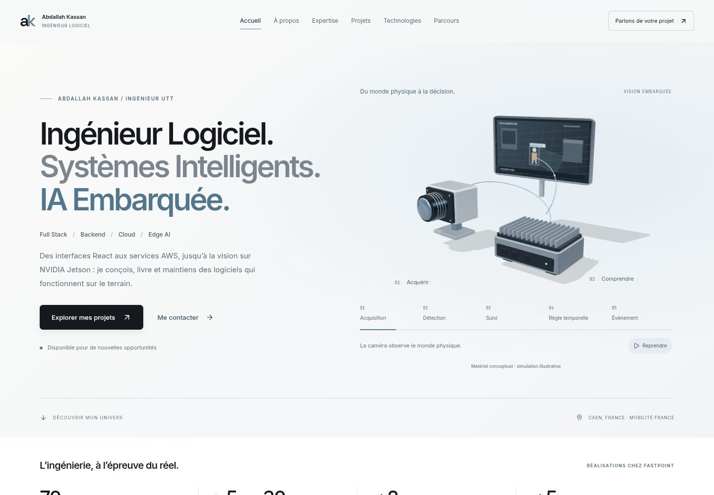
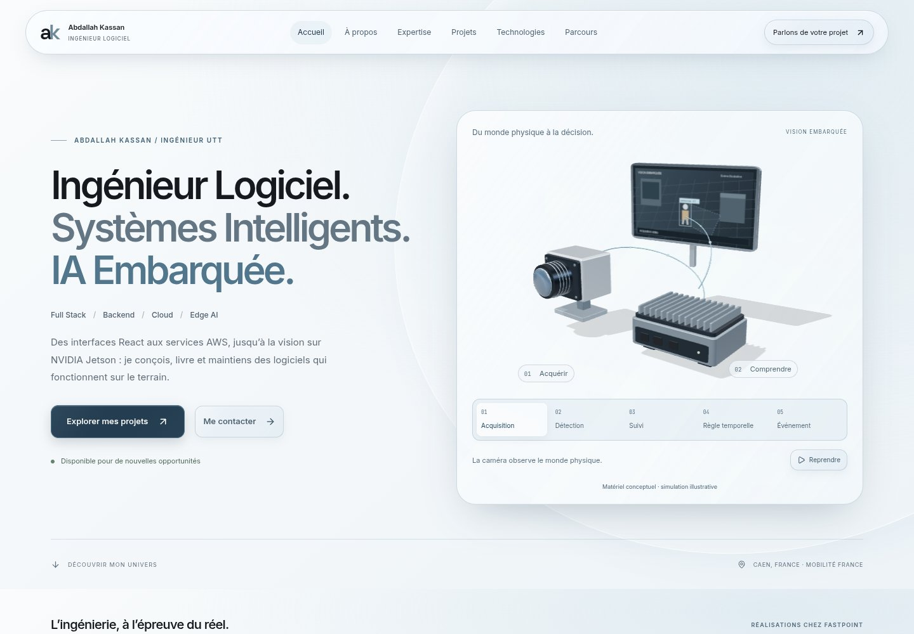
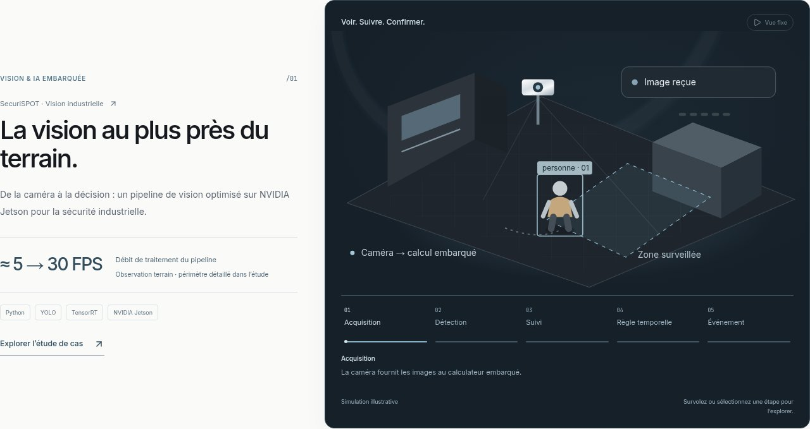
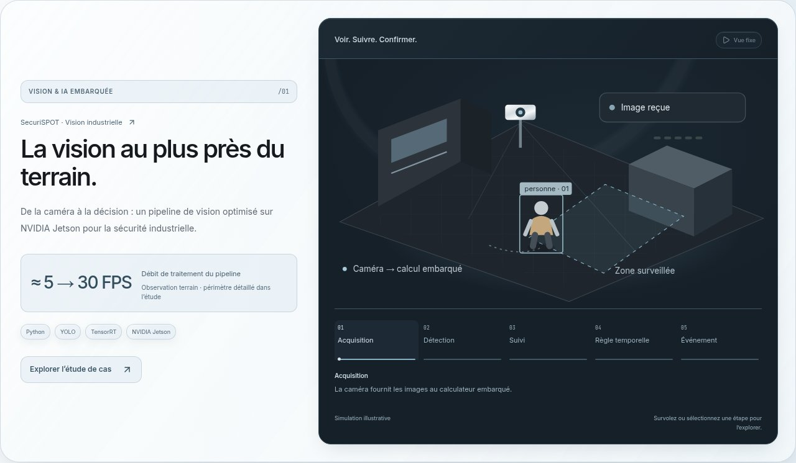
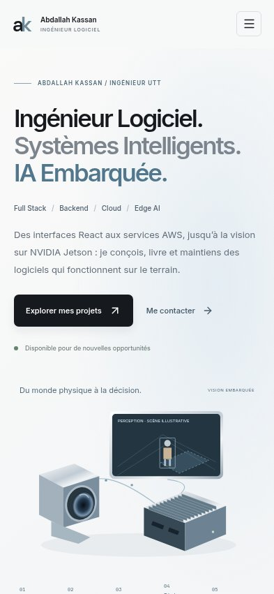
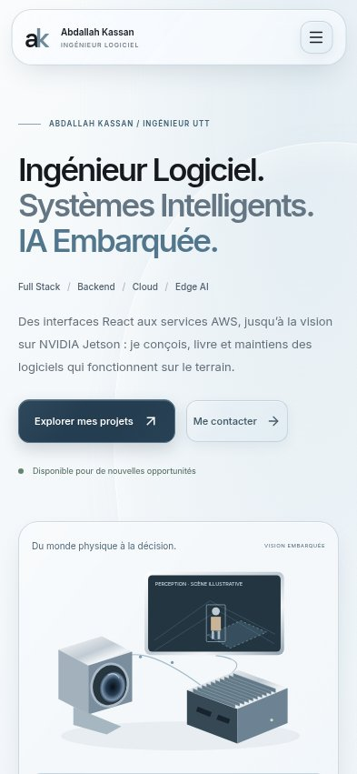
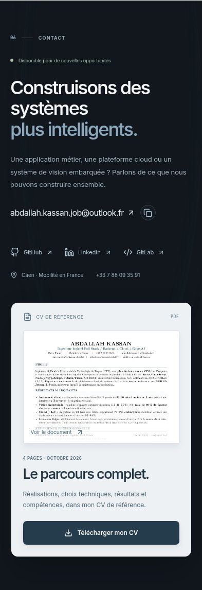
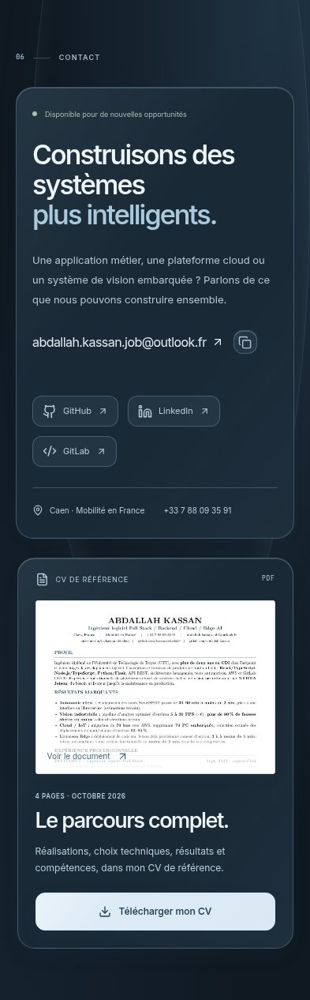

# Liquid Glass visual review

Based on restored, stabilized V2 `30d8449` on `main`. This is a presentation-layer upgrade on `feat/liquid-glass-v2`; it does not replace the engineering exhibition.

## Material system

`src/app/liquid-glass.css` is imported after the existing layout stylesheet. `.glass` supplies a reusable light material; `.glass--dark`, `.glass--raised`, `.glass--interactive`, `.glass--navigation` and `.glass--dialog` select material and elevation. The opt-in `.glass--optical` variant adds low blur to the hardware and about panels; navigation and dialogs have their own blur levels. Repeated project, expertise and technology cards use translucent layers without allocating extra backdrop filters. Tokens cover light/dark fills, solid fallbacks, directional reflections, edge highlights, inset controls, borders, three shadow levels, dialog elevation, three blur levels, radii, focus rings, durations and easing.

The pearl, graphite and steel-blue palette is shared across sections. Broad static illumination sits behind the surfaces. Internal edge highlights and faint directional reflections provide depth without animated decorative gradients. Text uses sufficiently dense backing layers; transparency is not applied to text or entire component trees.

On screens up to 640px, card grids use solid material backing and no backdrop filters. Blur is limited to navigation and active dialog surfaces at 10px. Browsers without backdrop-filter receive the solid material defaults. High-contrast preferences increase opacity; forced colors use system surfaces and borders. Reduced motion disables the added transitions and hover displacement.

No new dependencies, animation engine, shader, pointer listeners or continuous animation loops were added. All six simulation interiors remain opaque. Existing simulation clocks, IntersectionObservers, dialog handling and Three.js resource disposal are unchanged.

## Surface audit and final treatment

| Surface          | V2 baseline                              | Liquid Glass treatment                                                                                            |
| ---------------- | ---------------------------------------- | ----------------------------------------------------------------------------------------------------------------- |
| Navigation       | Full-width pale bar                      | Floating capsule, frosted fill, reflective top edge, active inset links, coordinated mobile drawer                |
| Hero             | Hardware on an open light background     | Elevated glass hardware enclosure, static atmospheric arc, inset stage controls and outlined labels               |
| Impact           | Flat metrics separated by rules          | Four coordinated interactive glass tiles with prominent numbers                                                   |
| About            | Open diagram and text                    | Raised diagram panel, translucent domain nodes, three supporting panels                                           |
| Expertise        | Four columns on graphite                 | Four dark-glass cards with recessed icon surfaces; readable single-column mobile cards                            |
| Six projects     | Open editorial rows and one dark feature | Unified elevated framing, metadata strips, inset metrics, tags and controls; original SVG demonstrations retained |
| Technology stack | Flat lists                               | Light-glass panels, polished icon tiles, restrained hover feedback; one column on small screens                   |
| Experience       | Bare timeline                            | Glass timeline panels with subtle illuminated connectors; supporting education/language panels                    |
| Contact          | Open graphite section                    | Dark-glass contact panel, reflective controls, coordinated CV card                                                |
| CV preview       | Original PDF image and download          | Same image, crop, file and URLs inside the new dark material shell                                                |
| Project dialogs  | Opaque light sheet                       | Dense frosted dialog, sticky glass toolbar, inset role and supporting panels                                      |
| Footer           | Dark footer                              | Coordinated graphite background, material edge and visible keyboard focus                                         |

## Components

- `Portfolio.tsx`: material class assignments for navigation, metrics, about, expertise, project frames, technologies, experience, contact and dialogs.
- `CoreVisual.tsx`: glass class assignment on the existing hardware wrapper.
- `EngineeringDemo.tsx`: instrument framing class only.
- `ResumeCard.tsx`: dark elevated material class only; preview markup and download props preserved.
- `layout.tsx`: imports the material stylesheet after `globals.css`.
- `HardwareScene.tsx`, `useSimulation.ts`, project data, all routes and the original layout stylesheet are unchanged.
- `tests/portfolio.spec.ts`: adds 360px and 393px to the existing overflow check; no assertions removed or weakened.
- `scripts/capture-glass.mjs`: reproducible visual capture and section overflow review at 320, 360, 393, 768, 1024 and 1440px.

## Before / after

### Desktop hardware hero (actual Three.js scene)

| Before                                                   | After                                                             |
| -------------------------------------------------------- | ----------------------------------------------------------------- |
|  |  |

### Project framing

| Before                                                   | After                                                             |
| -------------------------------------------------------- | ----------------------------------------------------------------- |
|  |  |

### Mobile

| Before                                                   | After                                                             |
| -------------------------------------------------------- | ----------------------------------------------------------------- |
|        |        |
|  |  |

## Full section gallery

Section captures use reduced motion for repeatable inspection. Desktop hardware captures above use the actual 3D scene, paused through its existing control. The separate functional suite exercises animation and Three.js initialization/cleanup. Section crops exclude the floating header so it does not obscure content; hero and mobile-menu images show the real navigation.

Chrome's SwiftShader screenshot path produced tiled artifacts on both unchanged main and the new design. Section captures therefore use Chrome's software rasterizer, while the existing WebGL tests retain their original SwiftShader configuration.

| Section      | Desktop, 1440px                                | Mobile, 393px                                 |
| ------------ | ---------------------------------------------- | --------------------------------------------- |
| Hero         | [Image](screenshots/after-1440-hero.jpg)       | [Image](screenshots/after-393-hero.jpg)       |
| Impact       | [Image](screenshots/after-1440-impact.jpg)     | [Image](screenshots/after-393-impact.jpg)     |
| About        | [Image](screenshots/after-1440-about.jpg)      | [Image](screenshots/after-393-about.jpg)      |
| Expertise    | [Image](screenshots/after-1440-expertise.jpg)  | [Image](screenshots/after-393-expertise.jpg)  |
| Vision       | [Image](screenshots/after-1440-vision.jpg)     | [Image](screenshots/after-393-vision.jpg)     |
| Manager      | [Image](screenshots/after-1440-manager.jpg)    | [Image](screenshots/after-393-manager.jpg)    |
| MediaSpot    | [Image](screenshots/after-1440-fleet.jpg)      | [Image](screenshots/after-393-fleet.jpg)      |
| Deployment   | [Image](screenshots/after-1440-delivery.jpg)   | [Image](screenshots/after-393-delivery.jpg)   |
| COLAS        | [Image](screenshots/after-1440-colas.jpg)      | [Image](screenshots/after-393-colas.jpg)      |
| ELK          | [Image](screenshots/after-1440-elk.jpg)        | [Image](screenshots/after-393-elk.jpg)        |
| Stack        | [Image](screenshots/after-1440-stack.jpg)      | [Image](screenshots/after-393-stack.jpg)      |
| Experience   | [Image](screenshots/after-1440-experience.jpg) | [Image](screenshots/after-393-experience.jpg) |
| Contact / CV | [Image](screenshots/after-1440-contact.jpg)    | [Image](screenshots/after-393-contact.jpg)    |
| Dialog       | [Image](screenshots/after-1440-dialog.jpg)     | [Image](screenshots/after-393-dialog.jpg)     |

Additional viewport captures: [320px](screenshots/after-320-hero.jpg), [360px](screenshots/after-360-hero.jpg), [768px](screenshots/after-768-hero.jpg), [1024px](screenshots/after-1024-hero.jpg), [mobile navigation](screenshots/after-393-navigation.jpg).

## Reproduce

Use Node.js 20.19 or newer, install locked dependencies with `npm ci`, run `npm run build`, then `npm run preview` in another terminal.

```sh
npm run lint
npm test -- --workers=1
node scripts/capture-glass.mjs after
```

Set `PLAYWRIGHT_CHROMIUM_EXECUTABLE_PATH` if using a system Chrome. To capture a separately served baseline, set `PORTFOLIO_PREVIEW_URL` and run the capture script with `before`. The script checks every major section for horizontal overflow at each requested width, and records browser errors in `screenshots/after-report.json`.

## Verification

- Node.js 20.19.4: ESLint, TypeScript during build, and Next.js static export pass.
- Full existing Playwright suite: **42 passed, 2 expected device-specific skips**, no retries on the final full local run. Covers project filters, history/deep links, native modal keyboard/focus behavior, clipboard, mobile navigation, animation clocks, offscreen/obscured pause, local demo interactions, reduced motion, missing WebGL, Three.js initialization/disposal, no-JavaScript content, PDF download and preview.
- After the final mobile deployment framing adjustment, targeted rollback, responsive-overflow and WCAG checks were rerun.
- Visual capture: every major section checked at **320, 360, 393, 768, 1024 and 1440px**; no horizontal overflow or browser JavaScript errors. Desktop and mobile images reviewed for alignment, hierarchy, reflections, contrast and clipping. Mobile technology columns, metric stacking, line breaks, dialog centering and deployment framing were corrected during review.
- Automated WCAG A/AA scans: no violations on the page or project dialog in desktop/mobile Chromium. Small metadata labels were additionally darkened for contrast over the light inset material; automated gradient contrast analysis alone is insufficient.
- Unsupported-backdrop fallback was exercised by evaluating backdrop-related CSS support branches as unsupported and removing unsupported filter declarations. All 35 material surfaces had opaque backing, with no WCAG violations on the page or dialog. [Fallback evidence](fallback-review.json) · [Screenshot](screenshots/after-1440-no-backdrop.jpg).
- Mobile material budget: only the rendered navigation filters the background on the normal page; hidden dialogs do not render. High-contrast preferences use opaque backing. No filters were introduced inside the SVG instruments.
- Existing CI retry/worker configuration and workflow are unchanged. No tests were removed or weakened; two additional viewport widths were added to the overflow test.
- Original PDF SHA-256: `7851b83eba479b97baf2261e6f085a27cda8ce12199de4dd1882b000e404d8b5`.
- Original preview SHA-256: `1218ef7008a51b1c78602a9c1bde843c0c44d5b9daceb267b60ea5f5c1118ab1`.

No known outstanding implementation issues. Browser verification used Chromium; native Safari/Firefox and physical mobile GPU testing were not performed. The unsupported-filter check is an emulation of the CSS fallback, not a test on an older browser. The existing local Next.js warning about an unrelated parent-directory lockfile does not prevent the static build.
